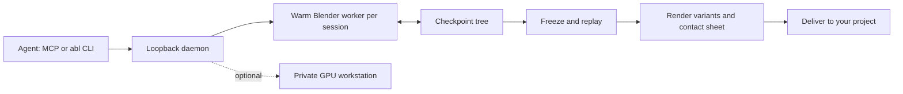

<div align="center">

# AgentBlender

### 3D assets, made by agents. Warm Blender workers. Reproducible results.

[](https://github.com/pevyhlas/agentblender/actions/workflows/ci.yml)
[](LICENSE)
[](#status)

[Quick start](#quick-start) · [How it works](#how-it-works) · [Agent guide](docs/agent-guide.md) · [Reference](REFERENCE.md) · [Contributing](CONTRIBUTING.md)

</div>

AgentBlender gives AI agents a **CLI and MCP server for Blender**. Build a scene, inspect a
small preview, branch from a checkpoint, and render a family of variants without restarting
Blender for every edit. Freeze the winning design into a replayable bundle and deliver stills
with provenance.

> **Experimental public preview.** Linux x64 is the qualified host. macOS arm64 is built and
> tested, but end-to-end and Metal qualification remain open. APIs and formats may change in
> 0.x releases. **No public packages yet: install from source.** See [release readiness](docs/public-readiness.md).

## What you get

| Capability | Why it matters |
|---|---|
| Warm, isolated workers | Iterate without repeated Blender startup; each agent gets its own scene. |
| Immutable checkpoint tree | Explore alternatives, branch safely, and reproduce a chosen trajectory. |
| Context-sized feedback | Delta state reads, 512 px previews, and one contact sheet per batch. |
| Explicit render tiers | Iterate locally; optionally use a private GPU workstation for heavy renders. |
| Portable delivery | Export replay bundles and verified still generations into your project. |
| Opt-in telemetry | No collection by default; send operational signals to your own collector. |

## AgentBlender or AgentGraphicDesign?

Use AgentBlender when form, light, material or camera matter: product renders, game props,
lighting studies and parameter sweeps (`batch_run`, judged in one contact sheet).
Finished stills leave through `delivery_export` for AgentGraphicDesign (`agd`) as raster input.
Use the companion [AgentGraphicDesign](https://github.com/pevyhlas/agentgraphicdesign) for
vector logos and marks, wordmarks, pixel art, and icon and platform kits. Motion rendering
and family delivery are not implemented. The [agent guide](docs/agent-guide.md) explains the
working loop, handoff and why the browser-based MCP Inspector is rejected by design.

## Quick start

Install **.NET SDK 10.0.113** and **Blender 5.2.1 LTS** separately. Point `ABL_BLENDER` at the
Blender executable, or put `blender` on `PATH`. AgentBlender never downloads or bundles Blender.

```bash
git clone https://github.com/pevyhlas/agentblender.git
cd agentblender
dotnet restore agentblender.slnx --locked-mode
dotnet build agentblender.slnx -warnaserror
bash scripts/install-local.sh

abl setup --dry-run             # review discovery and proposed configuration
abl setup
abl daemon start                # loopback only: http://127.0.0.1:7811
abl doctor
abl mcp config --client claude   # prints configuration; does not edit your client
# Or: abl mcp config --client opencode
```

If requested by the installer, add `~/.dotnet/tools` to `PATH`. Start with the
[agent authoring loop](docs/agent-guide.md) or the [CLI examples](REFERENCE.md#run-it).
`abl daemon stop` stops the daemon; `bash scripts/uninstall-local.sh` removes the tool while
keeping your scenes and configuration.

## How it works



The C# host owns sessions, checkpoints and delivery. Only `worker/` runs inside Blender.
Your project consumes exported artifacts, not a runtime dependency on AgentBlender.

**Trust boundary:** scene scripts run arbitrary Python with your local user privileges; this is
not a sandbox or a public service. The daemon binds loopback and rejects browser-origin
requests. Never expose it to the internet. See [security](SECURITY.md) before connecting agents
or a remote worker.

## Documentation

| I want to… | Read |
|---|---|
| Give an agent a useful working loop | [Agent guide](docs/agent-guide.md) |
| Configure, troubleshoot or run a user service | [Usage reference](REFERENCE.md#run-it) |
| Discover CLI/MCP operations | [Public surface](docs/public-surface.md) |
| Inspect part of a scene | [Scene inspection](docs/scene-inspection.md) |
| Move work between machines | [Portable bundles](REFERENCE.md#ship-it-to-a-repo) |
| Hand a finished still to AGD | [Still delivery contract](docs/still-delivery.md) |
| Understand release blockers and CI | [Public readiness](docs/public-readiness.md) |
| Understand the design | [Product](specs/product.md) · [Architecture](specs/architecture.md) |

## Status

One maintainer, a small number of projects, no general availability promise. Linux x64 is the
reference profile; there is no Windows daemon host. macOS and GPU-specific qualifications are
separate from a green CPU-only CI run. See the [changelog](CHANGELOG.md) for source changes
and the [readiness checklist](docs/public-readiness.md) for what remains before a packaged release.

## Contributing and license

GitHub Actions runs on fresh **GitHub-hosted runners**, including fork PRs, with SHA-pinned
actions, read-only permissions and no PR secrets. Start with [CONTRIBUTING.md](CONTRIBUTING.md);
report vulnerabilities privately through [SECURITY.md](SECURITY.md). This repository uses
[Product-Kit](https://github.com/pevyhlas/product-kit), vendored at **1.1.1** with no submodule
needed to clone or build.

AgentBlender is [MIT licensed](LICENSE). Blender is separately installed GPL software and is
never redistributed here; dependency notices are in [THIRD-PARTY-NOTICES.md](THIRD-PARTY-NOTICES.md).
AgentBlender is **not affiliated with or endorsed by the Blender Foundation**. “Blender” is a
trademark of the Blender Foundation, used only to describe compatibility.
