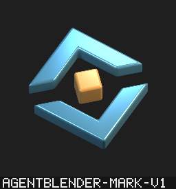

# AgentBlender emblem proposal



Original procedural geometry: two beveled brackets around a raised warm core.
This is a proposal for owner selection, paired with AGD's flat identity.

[Transparent 1024 px PNG](agentblender.png) · [Design philosophy](philosophy.md)
· [Editable Blender recipe](../../worker/artwork/brand_mark.py)

## Reproduce through AgentBlender

With Blender 5.2.1 and a running local daemon:

```sh
abl session open --project agentblender-brand
abl scene exec <session> --script worker/artwork/brand_mark.py
abl scene preview <session> --size 512 --engine cycles_cpu
abl trajectory freeze <session> --name agentblender-mark-v1
abl replay run agentblender-mark-v1
abl delivery export agentblender-mark-v1 --out deliveries --res 1024 --samples 64 --engine cycles_cpu
abl delivery verify <generation-dir> --json
```

Use a fresh artifact name if that name already exists. Delivery applies its fixed sRGB/Standard
profile; the interactive AgX preview has a softer highlight roll-off. Review the delivery's
contact sheet for the shipped appearance. CPU renders may differ slightly across platforms.

## Provenance

Original procedural geometry, materials, lights and camera; no external assets or fonts added.
Project MIT terms apply. Blender remains separately installed; this is not Blender Foundation
artwork or an endorsed mark. The recipe is an authoring example, not a packaged worker module.

The native session/exec/preview/freeze/replay flow passed with Blender 5.2.1 on Linux x64.
Offline AB delivery verification passed. AGD source build `0.3.0+4c08bd3` independently decoded
and verified the delivered 1024×1024 RGBA8 PNG. That check is not admission or rights verification.
Complete delivery and replay evidence is retained locally under change 012-brand-artwork.

PNG SHA-256: `224759645bdbe23105c400e7fe86c7fad9c404bde161020ab1ebc71654c2268d`.
Recipe SHA-256: `c769cba652a0b6de47303389ff1966a2604e1348942250eb3f66a4209f3aeba6`.
