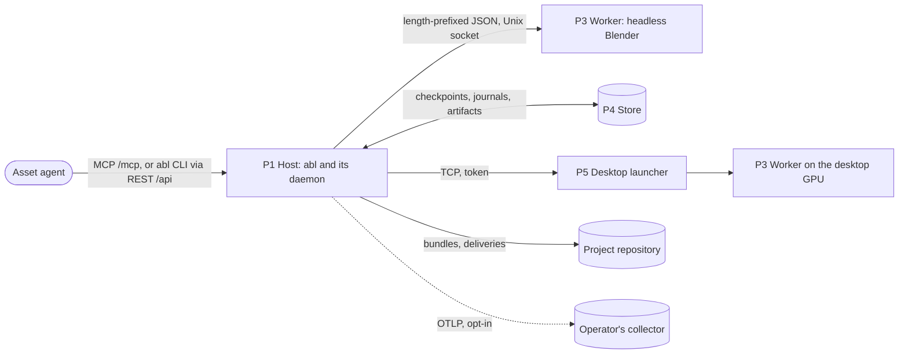
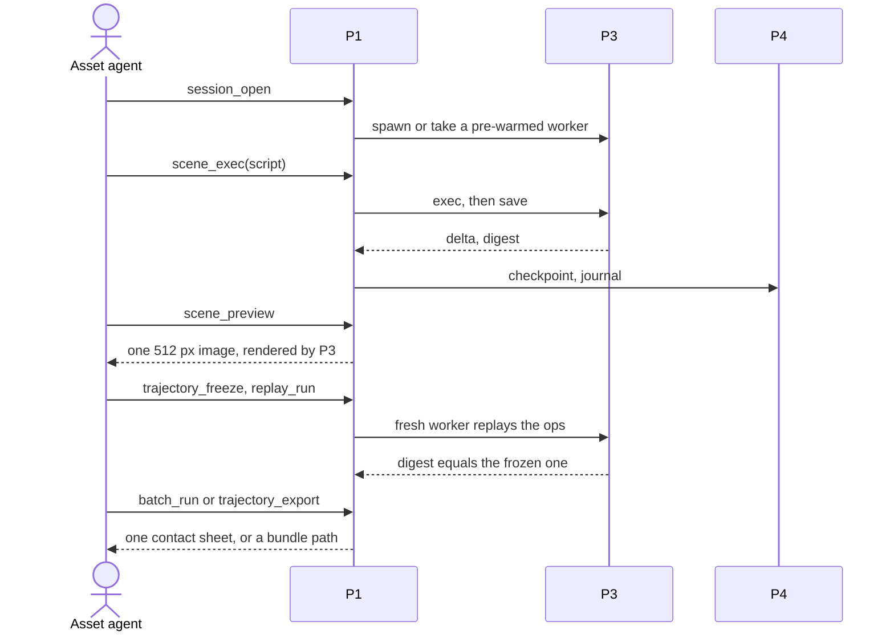

# AgentBlender — architecture

**Inherits**: none

One loopback daemon gives each agent session its own warm headless Blender worker over a
content-addressed checkpoint store, so iteration never pays a cold start and every state can be
branched, frozen and replayed.

## Shape

The store, sessions and renders are machine-local and disposable; bundles and deliveries in the
project repository are the durable form. Trust boundaries: loopback (daemon), the launcher's
token and single private bind (desktop), the worker process (GPL code).

## Parts

| Part | What it is | Why it exists | Components | Maturity | Spec |
|------|------------|---------------|------------|----------|------|
| P1 Host | the `abl` .NET tool: CLI and the loopback daemon it hosts | J-01 to J-06, R-01, R-06 to R-13, Q-01, Q-02, Q-04 | surfaces, sessions, operability, rendering, delivery, inspection, telemetry | validated | [p1-host](parts/p1-host.md) |
| P3 Worker | a headless Blender process running `worker/` | J-01 to J-06, R-03, R-05, R-09, R-13, C-02 | connection, exec and journal, save and digest, render and devices, contact sheet, inspection, blobs | validated | [p3-worker](parts/p3-worker.md) |
| P4 Store and replay | plain files under the store root, and the host code that freezes, replays, bundles and batches | J-01, J-02, J-03, R-02 to R-05, Q-03 | checkpoint store, trajectories, bundles, batch | validated | [p4-store-replay](parts/p4-store-replay.md) |
| P5 Desktop tier | the optional launcher on a GPU workstation, and its TCP transport | J-05, J-02, R-07, C-03 | launcher, routing, transfer | hypothesis | [p5-desktop-tier](parts/p5-desktop-tier.md) |

Parts that went and IDs that moved: [retired](architecture/retired.md).

## Core loop

Other journeys: J-04 runs P1 delivery over a P3 render into the project repository; J-05 runs
P1 through P5 to a P3 worker on the desktop, else locally; J-06 runs P1 operability and proves
a P3 round trip in `abl doctor`.

## Key decisions

- **Warm binary-hosted workers** (D-02): no interactive op pays a Blender cold start.
- **Checkpoint tree is the state model** (D-03): immutable snapshots and journals, never undo.
- **MCP is a thin wrapper** (D-04): one op core; MCP, REST and CLI cannot diverge.
- **One daemon, per-agent sessions** (D-11): a crash costs one session.
- **Bundles are the portable unit** (D-14): `artifact.json` plus `base.blend`, nothing else.
- **Desktop is a remote headless worker** (D-15): the host stays the brain and digest authority.
- **GPU backend model** (D-17): the worker detects OptiX or Metal; one host guard decides.

All of them: [decisions](architecture/decisions.md).

## Key areas

| Area | In a line | Detail |
|------|-----------|--------|
| Security and privacy | the network boundary is the security boundary; `scene_exec` runs arbitrary code by design | [security](architecture/security.md) |
| Observability and live site | opt-in OpenTelemetry with bounded labels; no content capture | [observability](architecture/observability.md) |
| Data | local, disposable store; durable bundles and deliveries in git | [data](architecture/data.md) |
| Interfaces | one op surface on three transports; versioned bundle, delivery and inspection formats | [interfaces](architecture/interfaces.md) |
| Environments | the user's Local host, an optional Desktop GPU worker, and CI | [environments](architecture/environments.md) |
| Operations | a .NET tool package, a release bundle, hosted CI, the vendored Product-Kit | [operations](architecture/operations.md) |

## Risks

- Warm workers degrade over a long life (leaks, drifting state): ops are transforms over
  checkpoints, so workers are disposable; see [why it works](architecture/why-it-works.md).
- The digest bound misses a difference a consumer cares about (node trees, modifier
  parameters): widening the bound is an L2 edit before code (P4.I-01).
- The desktop tier is rarely available: it is optional and falls back locally; its value is
  unmeasured.

## Left open

- MCP transports beyond streamable HTTP, chosen on usage evidence (D-04).

Owner-bound L1 questions (job queue, authentication, sandboxing, desktop fallback) are in the
[inbox](inbox.md).
