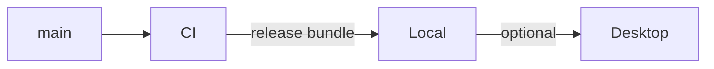

# AgentBlender — environments

<!-- Where the product runs. Each stage names its environment in product/lifecycle.md; one
environment can serve several stages. -->

AgentBlender is self-hosted only (N-02): there is no shared production service. Each user runs
their own Local environment; a Desktop GPU worker is optional.

| Environment | For | Provisioned in | Data | Who reaches it | A release gets there |
|-------------|-----|----------------|------|----------------|----------------------|
| Local | the user's iteration host running the daemon: Linux x64, or an Apple silicon Mac (C-12) | the user's own machine | the user's scenes, store and renders; leaves only by export | the user's agents on that machine, over loopback | the user installs the tool package from a release bundle (none published yet), or from a checkout with `scripts/install-local.sh` |
| Desktop | an optional GPU workstation serving finals and batches for one Local host | the user's own Windows or Linux machine on a private network | base checkpoints in, pixels out; nothing durable | that Local host, with the shared token | the user deploys the launcher with the `worker/` that matches the host version |
| CI | proving every change | GitHub-hosted runners of the public repository | test fixtures; Blender downloaded at test time, never committed | pull requests and pushes to main | every pull request and push to main |

- **Isolation**: environments share no store, secrets or identities; the desktop token lives in
  a private token file or `ABL_DESKTOP_TOKEN` on each end, never in the repository.
- **Data between environments**: only by explicit action: a bundle or delivery committed by the
  user, or a checkpoint shipped to the desktop for one job and its pixels back.
