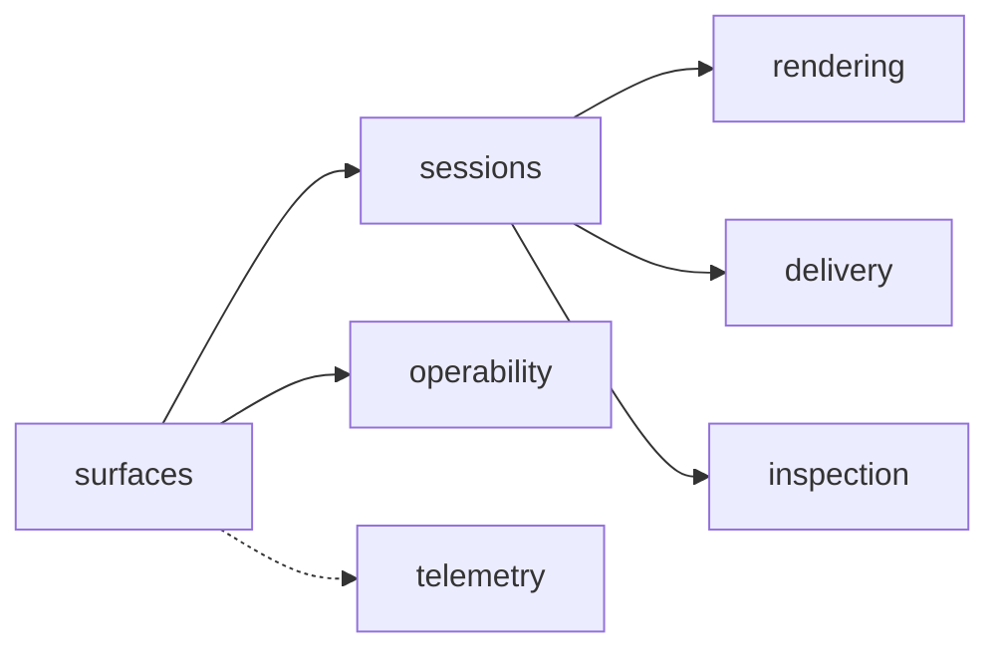

# P1 Host

**What it is**: the `abl` .NET tool (package `agentblender`): the CLI and the loopback daemon it
hosts, on the user's Local host · **Maturity**: validated · **Code**: `src/Abl.Cli/`,
`src/Abl.Daemon/`, `src/Abl.Core/`

## Why it exists

Every journey enters here. It exposes one op core on MCP, REST and CLI (R-01, J-01 to J-06),
runs each session on its own warm worker (R-06, Q-01, Q-04), keeps the daemon behind loopback
(C-03), sets itself up for a fresh agent (R-11, J-06), decides GPU requests honestly (R-13),
stages deliveries (R-08, J-04), serves inspection (R-09) and emits telemetry (R-10).

## Components

### Surfaces

MCP (`/mcp`, streamable HTTP), REST (`/api`, used by the CLI) and CLI verbs over one op core,
with the network guard in front.

- **P1.B-01 Surface parity**: the MCP tool set, REST routes and CLI verbs enumerate the same ops;
  any drift fails the build. Test: `SurfaceParityTests`.
- **P1.B-02 Host and Origin guard**: before routing, on every route, a request whose `Host`
  name is not `127.0.0.1`, `localhost` or `[::1]` gets 421 (missing `Host` 400); a present
  `Origin` other than `http://<loopback name>` on the request's port gets 403, `null`
  included. The port is not checked, so port-remapping tunnels work. Test: `HostGuardTests`,
  `HostGuardSocketTests`.
- **P1.B-03 Structured errors**: every surface returns `{kind, message, hint?, lastCheckpoint?}`;
  a dead worker's error carries `lastCheckpoint`, so recovery is one `checkpoint_branch` call.
  Test: `WorkerErrorsTests`, `SessionIsolationTests`.
- **P1.B-04 Caller deadlines**: CLI requests have no implicit total deadline; an explicit
  deadline or Ctrl-C cancels with an actionable error, independent of worker timeouts.
  Test: `CliHttpTests`, `CallerCancellationTests`.
- **P1.I-01 Loopback bind**: the daemon listens on IPv4 loopback only; no configuration or
  environment value widens it. Enforced by: `EndToEndTests.DaemonRefusesNonLoopbackBindOverride`.
- **P1.I-02 Thin layers**: MCP and REST handlers hold no op semantics; they call the core.
  Enforced by: owner review, `SurfaceParityTests`.
- **P1.I-03 One telemetry choke point**: every op on every surface passes one op context, so
  outcome and serving tier are recorded on success and failure alike. Enforced by:
  `BindingAndTelemetryHygieneTests`.

Context-economical defaults (Q-02): terse text, one image where an image is needed, paths
instead of pixels for finals. Browser-based tools (an MCP inspector page) are rejected by
design.

### Sessions

Session lifecycle, the worker pool and supervision, and the exec pipeline:
[sessions](p1-host/sessions.md).

### Operability

Configuration, Blender discovery, runtime paths, the daemon lifecycle, user services, doctor,
agent guidance and packaging: [operability](p1-host/operability.md).

### Rendering

The single-slot GPU lease and the GPU guard: [rendering](p1-host/rendering.md).

### Delivery

Stages one procedural still per generation for a consuming project (R-08, J-04). Contract:
[still contract](../../docs/still-delivery.md).

- **P1.B-24 Fresh, complete generations**: `delivery_export` builds a generation in a staging
  directory and makes it visible only once complete and verified; it never replaces an earlier
  generation, and a failed, conflicting or cancelled export leaves no partial one. Test:
  `DeliveryExportTests.StillPublishesCompleteSeparatePayloadAndPreservesPriorGeneration`.
- **P1.B-25 Exact payload**: the payload holds exactly the AGD provided-artifact v1 descriptor
  and an 8-bit RGBA PNG; the producer receipt, recipe snapshot, replay bundle and contact sheet
  sit beside it; new receipt/snapshot pairs record the effective producing Blender support policy
  under the [still contract](../../docs/still-delivery.md#producing-blender-policy); the pinned AGD receiver accepts it. Test:
  `DeliveryExportTests.PublicStillOutputPassesPinnedCliAndMcpReceiverAndIndependentSamples`,
  `DeliveryDescriptorTests`, `PngProfileTests`.
- **P1.B-26 Offline verify**: `delivery_verify` and `delivery_list` run the same bounded checks
  offline; tampered, extra, missing, oversized or symlinked files fail, and a pass claims
  integrity, never admission. Historical absent policy remains unknown; present policy must be
  consistent with its recorded line/reference and agree across receipt/snapshot, independently of
  today's supported Blender. Test: `DeliveryVerifyTests`.
- **P1.B-27 No user symlinks**: a delivery path with a symlink in any component is refused,
  except a system alias whose containing directory is root-owned and writable by no one else.
  Test: `DeliveryVerifyTests.UserCreatedSymlinkInADeliveryPathIsRefused`,
  `DeliveryVerifyTests.SystemTempAliasesAreAllowed`.

### Inspection

Bounded scene measurements instead of screenshot judgment (R-09). Contract:
[inspection contract](../../docs/scene-inspection.md).

- **P1.B-28 Read-only inspection**: `scene_inspect` returns the versioned
  `abl.scene-inspection.v1` profile within stated limits, never advances the head or consumes
  the pending delta, and gives the same structured result on CLI, REST and MCP; a malformed
  worker reply keeps the checkpoint. Test:
  `SceneInspectionTests.InspectionDoesNotConsumePendingDeltaAndObservesLooseEdges`,
  `SceneInspectionTests.InvalidFactsAndMalformedReplyPreserveCheckpoint`,
  `InspectionWireTests.ActualCliRestAndMcpShareStructuredReadContract`.

### Telemetry

Opt-in OpenTelemetry through the op context (P1.I-03): see
[observability](../architecture/observability.md).

## Interface guarantees

- Op surface: experimental; ops and fields may change in any 0.x release, but never differently
  on one surface than another. Schema: `src/Abl.Core/OpSurface.cs`,
  [public surface](../../docs/public-surface.md).
- Host verbs and `daemon_status`: see [interfaces](../architecture/interfaces.md).

## Failure semantics

- A worker failure surfaces as a structured error for that session only; the daemon keeps
  serving other sessions.
- An invalid configuration file or variable stops the daemon before it binds, naming the file,
  key and check ID.

## Left open

- An IPv6 loopback listener (IPv4 only today).
