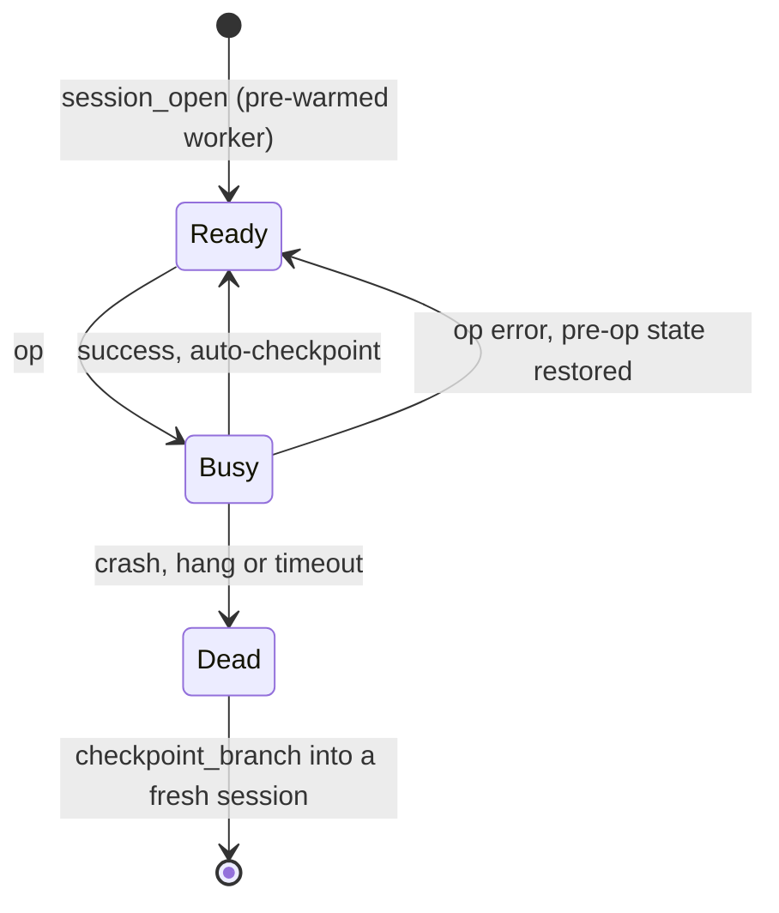

# P1 Host — sessions

**Code**: `src/Abl.Core/Sessions/`, `src/Abl.Core/Workers/` · **Decisions**: D-02, D-11

Each session owns one warm headless worker and a head pointing into the store (R-06, J-01). The
host supervises workers over a length-prefixed JSON socket; the worker is the only code that
touches Blender (C-02).

- **P1.B-05 Warm first op**: a pool keeps pre-warmed ready workers, so a new session's first op
  pays no Blender start in the op path; no two sessions ever share a worker. Test:
  `SessionIsolationTests.InterleavedSessionsNeverCrossObserve` (no sharing); the warm first op
  is unenforced.
- **P1.B-06 Atomic ops**: a failed exec leaves the head at its pre-op state with a structured
  cause; a second op on a busy session is refused, never interleaved. Test:
  `ExecAtomicityTests`.
- **P1.B-07 Contained failure**: a crashed or hung worker, or an op past its timeout, is killed
  and recycled; only its session dies, and it recovers from its last checkpoint. Test:
  `SessionIsolationTests.KilledWorkerIsContainedAndRecoverableWithinTenSeconds`,
  `TimeoutRecycleTests`.
- **P1.B-08 Temporary render state**: render-request overrides (format, samples, device, seed,
  denoiser, GPU preferences) are restored before success or an ordinary render error; a failed
  restoration kills the worker rather than reporting a ready session. Test:
  `RenderStateIsolationTests`.
- **P1.I-04 Checkpoints open in Blender**: every stored checkpoint loads in a fresh worker.
  Enforced by: `CheckpointOpenabilityTests`.

## Left open

- Worker recycling by op count or age (today: on timeout and crash only).
- Session liveness across a daemon restart (the store survives; sessions do not).
