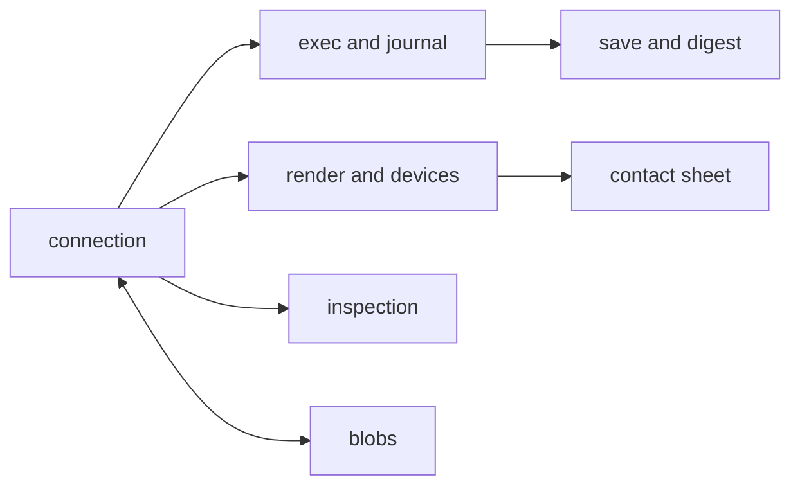

# P3 Worker

**What it is**: a headless Blender process (`blender --background --factory-startup`) running
`worker/`, spawned by the host on the Local host or by the launcher on the Desktop · **Maturity**:
validated · **Code**: `worker/`

## Why it exists

Every journey that touches a scene (J-01 to J-06) needs Blender, and only this part may load it
(C-02). It runs caller scripts against a warm scene and saves checkpoints with a canonical
digest, so designs replay (R-03) and batches fan out (R-05); it renders, composes the one
contact sheet and measures scenes (R-09); and it detects and selects GPU devices itself, so the
host can report them honestly (R-13).

## Components

### Connection

One blocking request loop over the socket the host (or launcher) listens on: a Unix socket
locally, TCP on the Desktop.

- **P3.B-01 Identity hello**: `hello` reports the Blender version and build hash, the worker
  source digest over its modules, the Python version, the GPU capability (P3.B-07) and
  `capabilities.blob_chunks`. Test: `DoctorRoundtripTests.AC25_TheRoundTripSpawnsBlenderAndReportsItsIdentity`,
  `WorkerProtocolTests.FullProtocolRoundTrip`.
- **P3.B-02 Warm**: `warm` runs a 64 px EEVEE throwaway render (unless `prewarm_render` is
  false) and resets the journal, so the first real render pays no shader compile in the op
  path (P1.B-05). Test: `DoctorRoundtripTests.AC25_TheRoundTripSpawnsBlenderAndReportsItsIdentity`
  (every spawn warms); the hosted lane's install step checks that EEVEE renders headless
  (that lane is advisory until its first green hosted run).
- **P3.I-01 One request in flight**: the loop is Blender's main thread, with no timers or
  threads; a request is read, handled and answered before the next is read. Enforced by: owner
  review (`worker.py` main loop); the host refuses a second op on a busy session (P1.B-06).
- **P3.I-02 Bounded frames**: a message is a 4-byte big-endian length and UTF-8 JSON; a length
  over 64 MiB ends the connection before anything is allocated. Files move as blobs (P3.B-12).
  Enforced by: owner review (`worker.py`); the host's codec: `WorkerTransfersTests`.
- **P3.I-03 Structured errors**: a deliberate failure (`bad_request`, `gpu_unavailable`, a blob
  or inspection error) answers with its kind and message and no traceback; any other exception
  answers with its type and a traceback bounded to 4000 characters. Enforced by:
  `RenderErrorTests`, `WorkerErrorsTests`.
- **P3.I-04 Connection-owned temps**: temporary files the worker keeps across ops (shipped
  bases, kept renders, partial blobs) are deleted when the connection ends; after a hard kill
  the OS temp policy is the backstop. Enforced by:
  `RemoteTempCleanupTests.FailedRemoteRenderSheetAndKeptLoadRemainConnectionOwned`,
  `tests/test_blob_transfers.py`.

### Exec and journal

Runs caller code against the open scene (R-01, J-01).

- **P3.B-03 Exec**: `exec` runs a script by path, or inline `source` on a remote worker, with
  `params` in its namespace, and returns the state delta since the last read (added, removed
  and changed objects). Test: `WorkerProtocolTests.FullProtocolRoundTrip`, `EndToEndTests`.
- **P3.B-04 Recover before reporting**: with `recover_to`, an exec that raises reopens that
  checkpoint and resets the journal before it reports the error; when the reopen itself fails,
  the worker exits so the host reports `worker_died` with the last checkpoint, never a ready
  session in an unknown state. Test: `ExecAtomicityTests.FailedExecRestoresPreOpStateAndHead`;
  the failed reopen is unenforced.

### Save and digest

Turns the scene into a checkpoint and its replay identity (R-03, D-03).

- **P3.B-05 Save**: `save` writes a compressed copy of the open file and returns its size, the
  canonical scene digest and the Blender version. Test: `WorkerProtocolTests.SaveIsByteStable`,
  `CheckpointOpenabilityTests`.
- **P3.I-05 One digest construction**: the digest is computed only in `worker/fingerprint.py`,
  over exactly the bound of P4.I-01, from scene content and never from `.blend` bytes. Enforced
  by: `ReplayDeterminismTests`.

### Render and devices

Renders on request and owns GPU device detection and selection (R-13, D-17).

- **P3.B-06 Render**: `render` takes `eevee`, `cycles_gpu`, `cycles_cpu` or `workbench`; any
  other engine is `bad_request` naming the valid set, and the worker keeps serving. With
  `profile` it writes the delivery still (8-bit RGBA PNG, sRGB, Standard view, straight alpha
  over a transparent film) and reports the effective settings. Every override is restored
  afterwards (P1.B-08). Test: `RenderErrorTests`, `DeliveryExportTests.DeliveryProfileRestoresEveryOverriddenSetting`,
  `RenderStateIsolationTests`.
- **P3.B-07 Read-only GPU detection**: `hello` probes OptiX, then Metal, and reports
  `gpu: {backend, devices, metalrt}` (`none` with no devices when neither is usable) without
  assigning any preference; a detection fault fails the hello rather than advertise a GPU it
  could not read. Test: `tests/test_cycles_devices.py`,
  `GpuDeviceTests.SecondHello_ReportsOptixAndLeavesExistingPreferenceEntriesUnchanged`
  (OptiX qualification), `MetalQualificationTests`.
- **P3.B-08 Per-render selection and check**: before every `cycles_gpu` render the worker
  selects the backend's devices (Metal: only Metal devices, OpenImageDenoise on the GPU;
  OptiX: every listed entry) and checks that one is active; a rejected value or a failed check
  is `gpu_unavailable` before anything renders. The reply's `device` names what was configured
  and checked, never proven execution. Test: `tests/test_cycles_devices.py`,
  `RenderStateIsolationTests.WorkerRaisedGpuUnavailable_RendersNothingAndPreservesSavedSettings`
  (OptiX qualification), `MetalQualificationTests`.
- **P3.B-09 Pixels for a remote host**: with `return_blob` (or `return_bytes`) the render goes
  to a unique temp the connection owns and comes back as a blob (or inline PNG), so the pixels
  land on the host's disk (P5.I-04). Test: `RemoteWorkerTests`, `RemoteBatchTests`.

### Contact sheet

The one image a batch returns (R-05, D-07).

- **P3.B-10 Sheet in the worker**: `contact_sheet` composes labelled renders into one grid PNG
  inside the worker with numpy, never with host-side imaging; remotely it composes from its own
  kept renders and ships the sheet back. Test:
  `BatchContactSheetTests.NineVariantsYieldNineRendersAndExactlyOneSheet`, `RemoteBatchTests`.

### Inspection

Bounded measurements for agents (R-09).

- **P3.B-11 Bounded inspection**: `inspect` returns the selected observations under
  `abl.scene-inspection.v1` within its work budgets, and neither advances the journal nor saves.
  Test: `SceneInspectionTests` (P1.B-28 is the host half).

### Blobs

The worker half of chunked transfer (P5.B-04).

- **P3.B-12 Verified chunks**: uploads and downloads move in ordered chunks of at most 1 MiB
  with length and SHA-256 checks; a bad offset, bound or hash never loads a checkpoint, and a
  disconnect deletes partial uploads. Test: `tests/test_blob_transfers.py`,
  `WorkerTransfersTests`.

## Interface guarantees

- Worker protocol: experimental, and versioned with the host: host and worker ship together
  (the tool package carries `worker/` and a manifest of it, P1); the host refuses a hello shape
  it does not know as `worker_upgrade_required`. Schema: [worker protocol](../../docs/worker-protocol.md).

## Failure semantics

- A script error is an op error and the scene is back at the pre-op checkpoint (P3.B-04); a
  crash, hang or timeout kills the worker and costs only its session (P1.B-07).
- A failed render-state restore exits the worker instead of reporting a ready session (P1.B-08).
- No GPU backend: `cycles_gpu` fails with `gpu_unavailable` before rendering; other engines run.

## Budgets

- Cold start about 1.4 s and a warm round trip well under a millisecond on the reference
  Blender ([observed](../observed.md)); a first EEVEE render compiles shaders, which warm absorbs.

## Left open

- Recycling a worker by op count or age (P1 sessions).
