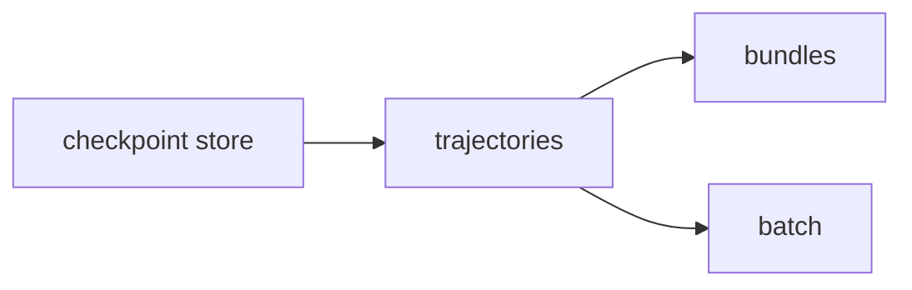

# P4 Store and replay

**What it is**: plain files under the store root on the Local host, and the host code that
freezes, replays, bundles and batches them · **Maturity**: validated · **Code**:
`src/Abl.Core/Store/`, `src/Abl.Core/Trajectories/`, `worker/fingerprint.py`

## Why it exists

J-01, J-02 and J-03 need design state that branches, freezes, replays and travels (R-02 to R-05,
Q-03): the store holds it, trajectories prove it, bundles carry it to a repository and batch
fans it into a family.

## Components

### Checkpoint store

Immutable checkpoints with parent links, tags and per-session journals as plain files (R-02).

- **P4.B-01 Auto-checkpoint**: every successful exec saves a checkpoint and advances the
  session head (a failed exec: P1.B-06). Test: `ExecAtomicityTests`.
- **P4.I-02 Byte addressing is storage only**: a checkpoint's id is the SHA-256 of its file
  bytes, used for dedup and integrity, never as replay proof. Enforced by: `CheckpointStoreTests`.
- **P4.I-03 Prune safety**: prune never deletes a live session head or a checkpoint a frozen
  artifact references, and deletes a tagged one only when forced. Enforced by:
  `CheckpointStoreTests.PruneRefusesProtectedTaggedAndFrozenReferencedHashes`,
  `BundleRoundTripTests.ImportedBaseIsPruneProtected`.
- **P4.I-07 Safe references**: checkpoint references, artifact names and tags used in file
  paths are validated against traversal. Enforced by:
  `CheckpointStoreTests.PathUnsafeReferencesAreRejected`.

### Trajectories

Freeze a journal range and prove it on a fresh worker by scene content (R-03, Q-03).

- **P4.B-02 Replay**: `replay_run` loads the base on a fresh local worker, runs the frozen ops
  and passes only on digest equality; on a Blender version mismatch it reports both versions.
  Test: `ReplayDeterminismTests`.
- **P4.I-01 Replay gate bound**: replay PASS means equal canonical scene digest. Covered: object
  set, parent hierarchy, settled world transforms and mesh vertex coordinates (rounded 1e-5),
  loop topology, light type, energy and colour, camera lens, used-material names and viewport
  colours, modifier stacks (name and type), visibility flags, collection names. Not covered:
  material and geometry node trees, modifier parameter values, custom properties, render
  settings, pixels. Widening the bound is an L2 edit before code. Enforced by:
  `ReplayDeterminismTests`.
- **P4.I-06 Digest authority on the host**: replay and digest comparison never run on the
  desktop tier. Enforced by: owner review (`TrajectoryService`).

### Bundles

Git-portable frozen artifacts that need no trust in the transport (R-04, J-03).

- **P4.B-03 Bundle round trip**: export from one store and import into a store that never saw
  it reconstitutes an artifact that replays PASS. Test: `BundleRoundTripTests`,
  `BundlePortabilityTests`.
- **P4.I-04 Import verifies before writing**: a bundle whose `base.blend` hash differs from the
  recorded base, whose `artifact.json` is malformed or oversized, or which contains symlinks is
  refused with zero store mutation; identical re-import is a no-op; different content under an
  existing name is refused. Enforced by: `BundleRoundTripTests`.
- **P4.I-05 Deterministic bundle bytes**: re-export of an unchanged artifact is byte-identical
  (fixed key order, no wall-clock values). Enforced by: `BundleRoundTripTests.ReExportIsByteIdentical`.

### Batch

One frozen artifact across a parameter table (R-05, J-02).

- **P4.B-04 Batch**: each variant renders to its own unique default path and the batch returns
  one contact sheet. Test: `BatchContactSheetTests`, `RemoteBatchTests`.

## Interface guarantees

- Bundle `formatVersion` 1: experimental; a breaking change bumps the version and import refuses
  unknown versions. Schema: `src/Abl.Core/Store/CheckpointStore.cs`.

## Failure semantics

- A worker crash mid-exec leaves the store at the last good checkpoint; the session is dead and
  recoverable with `checkpoint_branch`.
- A replay FAIL is a result, not an error: it names the expected and actual digests.

## Left open

- Store garbage collection beyond explicit prune.
