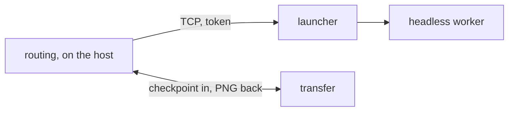

# P5 Desktop tier

**What it is**: the optional launcher on a Windows or Linux GPU workstation (the Desktop
environment), and the host's TCP transport to it · **Maturity**: hypothesis · **Code**:
`src/Abl.Launcher/`, `src/Abl.Core/Workers/DesktopTier.cs`,
`src/Abl.Core/Workers/DesktopHandshake.cs`, `src/Abl.Core/Workers/WorkerTransfers.cs`,
`worker/blobs.py`

## Why it exists

J-05 and J-02 need heavy work off the iteration host (R-07) within the network boundary (C-03):
an optional GPU workstation serves final renders and batches as a headless worker the host
drives, outside the interactive loop, behind one private address and an authenticated host.

## Components

### Launcher

The system's only non-loopback listener, on the GPU workstation (C-03, D-15).

- **P5.I-01 Specific bind**: the launcher refuses wildcard binds (`0.0.0.0`, `::`, `*`, `+`).
  Enforced by: `DesktopTransportTests.BindGuardRefusesWildcardInterfaces`.
- **P5.I-02 Token before spawn**: the launcher checks the bearer token in constant time before
  starting any Blender process. Enforced by: `DesktopTransportTests.HandshakeAcceptsMatchingTokenAndRejectsWrongOne`.
- **P5.I-03 Headless factory startup**: the launcher only starts `--background --factory-startup`
  workers, never a GUI Blender. Enforced by: owner review (`LauncherHost`).

### Routing

Decides on the host which tier serves a job (R-07).

- **P5.B-01 Routing**: interactive ops and replay always run locally; `render_final` and
  `batch_run` prefer the desktop when configured and the cached probe says reachable.
  Test: `RemoteWorkerTests.RoutesRenderToDesktopThenFallsBackToLocal`,
  `RemoteBatchTests.RoutesBatchToDesktopThenFallsBackToLocal`.
- **P5.B-02 Bringup fallback**: when the desktop is unreachable, rejects the token, times out
  on connect or needs a worker upgrade, the job runs on the local tier and the result carries a
  bounded `fallbackReason`. Test: `RemoteWorkerTests`, `RemoteBatchTests`.
- **P5.B-03 Unconfigured is local**: with the desktop endpoint or token unset, every render runs
  locally exactly as without the tier. Test: `DesktopTransportTests.ProbeIsFalseWhenUnconfigured`.
- **P5.B-05 GPU bringup**: for a `cycles_gpu` render or batch, a desktop worker reporting no
  GPU backend is a bringup failure (`desktop_bringup_failed`) and the job runs locally; other
  engines still run on that desktop; an older hello shape is `worker_upgrade_required`. Test:
  `GpuContractTests.DesktopRenderRouting`, `GpuContractTests.DesktopBatchRouting`.

### Transfer

Moves checkpoints in and pixels back over the TCP worker protocol.

- **P5.B-04 Chunked transfer**: with `blob_chunks`, checkpoints and PNGs move in ordered 1 MiB
  chunks with length and SHA-256 checks; a download publishes only after verification; a
  disconnect removes connection-owned partial files. Test: `WorkerTransfersTests`,
  `RemoteTempCleanupTests`, `tests/test_blob_transfers.py`.
- **P5.I-04 Pixels land on the host**: rendered PNGs and contact sheets are shipped back and
  written on the host disk, referenced by the sidecar with the serving tier. Enforced by:
  `RemoteWorkerTests`.

## Interface guarantees

- Host and launcher with bundled `worker/` are upgraded together. The host refuses a hello
  shape it does not know as `worker_upgrade_required`; the job then runs on the local tier with
  `fallbackReason` `worker_upgrade_required`. Every worker from before chunked transfer reports
  such an older shape, so no released desktop worker serves renders without
  `capabilities.blob_chunks`, which gates chunked transfer. Schema:
  [worker protocol](../../docs/worker-protocol.md).

## Failure semantics

- A failure after desktop rendering starts is surfaced as an error attributed to the desktop
  tier; it never kills the originating local session.
- TCP reachability is not proof of token, Blender or GPU readiness; only a `tier=desktop` render is.

## Budgets

- Probe: bounded, a few seconds, cached briefly so a batch of ops does not re-probe.

## Left open

- The probe's exact timeout and cache lifetime, within the budget above.
