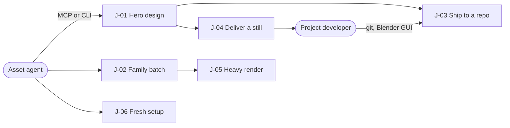

# AgentBlender

An agent-native 3D asset pipeline on Blender: AI agents design, batch, reproduce and deliver
rendered assets into a project's repository without a human 3D artist.

**Stage**: Public preview · next: GA ([lifecycle](product/lifecycle.md))

## Problem

Agents that need 3D-rendered assets (hero models, prop families, icon sets) cannot drive raw Blender affordably.

| Pain today | Evidence | Solved by |
|------------|----------|-----------|
| Every call pays a Blender cold start, so iteration is slow | measured: about 1.4 s cold start against a 0.3 ms warm round trip ([observed](observed.md)) | J-01 |
| No state model for branching exploration; programmatic undo is unreliable | desk research: prior-art survey ([archive](archive.md#prior-art-survey), [observed](observed.md)) | J-01 |
| Scene dumps and one image per item flood model context | assumed, sized in the spike: a 512 px preview is about 350 tokens | J-01, J-02 |
| A rendered result cannot be reproduced or shared through git | measured: `.blend` bytes differ across processes ([observed](observed.md)) | J-03 |
| Consumer projects receive hand-copied files without provenance | assumed | J-04 |
| Heavy renders on a small iteration GPU block the loop | assumed: an always-on iteration host typically has a small GPU | J-05 |
| Setup cost kept agents to smoke previews | observed on a pilot project | J-06 |

## Who it is for

| Persona | Wants | Situation | Uses |
|---------|-------|-----------|------|
| Asset agent | finished, verified 3D assets for a project, in few tokens | a non-interactive AI coding agent, often one of several at once across projects, on the developer's host | MCP tools or the `abl` CLI |
| Project developer | assets that land in their repository reproducibly, without 3D skills | directs agents, reviews results, opens a scene in Blender's GUI when curious | git, Blender's GUI, their project |

Not personas: whoever hosts AgentBlender or runs a desktop GPU worker (C-12, [environments](architecture/environments.md)).

## Journeys

**Core loop**, the journeys the bet depends on: J-01 Hero design → J-02 Family batch → J-03 Ship to a repo.

| Area | Public preview (now) | GA |
|------|----------------------|----|
| Design | [J-01 Hero design](product/journeys/j-01-hero-design.md), [J-02 Family batch](product/journeys/j-02-family-batch.md) | |
| Ship | [J-03 Ship to a repo](product/journeys/j-03-ship-to-a-repo.md), [J-04 Deliver a still](product/journeys/j-04-deliver-a-still.md) | |
| Render | [J-05 Heavy render](product/journeys/j-05-heavy-render.md) | |
| Setup | [J-06 Fresh setup](product/journeys/j-06-fresh-setup.md) | |

## What must be true

- Every capability works for a non-interactive agent on MCP and CLI alike (R-01).
- Design state is a branchable tree of immutable checkpoints, never undo (R-02).
- A frozen design reproduces the same scene content on any machine with the pinned Blender (R-03).
- Context stays bounded: deltas, 512 px previews, one contact sheet per batch (Q-02).
- Only `worker/` touches Blender; Blender is never redistributed (C-02).
- The daemon is reachable only from loopback clients (C-03).
- A fresh agent sets it up without a source build or hand-set environment (R-11).

Everything else: [requirements](product/requirements.md), [qualities](product/qualities.md),
[constraints](product/constraints.md), [non-goals](product/non-goals.md); all bind every change.

## The bet

Warm workers, a checkpoint tree and context-economy contracts make agent-driven 3D asset work
affordable enough for real project deliverables. Wrong if, once setup friction is gone (R-11),
agents still use AgentBlender only for smoke previews and projects take no delivered assets.

## Waiting on the owner

All in the [inbox](inbox.md):

- Confirm the restructured spec and the Public preview stage.
- Settle four canon conflicts: desktop fallback, telemetry attribution, checkpoint cadence, `bpy`.
- Decide when the deferred hardening (job queue, formats, authentication, sandboxing) is due.
- Run the macOS qualification, and give the go for the first public release.
