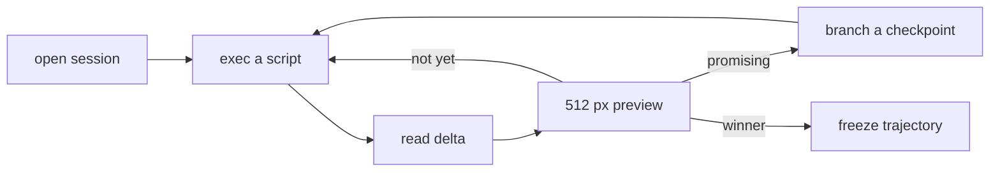

# J-01 Hero design (hypothesis)

**Who**: asset agent · **Area**: Design · **Surfaces**: MCP tools or the `abl` CLI; Blender's GUI
for optional inspection

## Intent

Iterate one asset (a character, a hero prop) to a design worth keeping, exploring alternatives
without losing good states, and freeze the winner, in few tokens and without a human step.

## Situation

The agent works for a project developer, often beside other agents in other sessions on the same
host. It sees the scene only through text and small images, and every byte it reads costs
context.

## Scenario

1. Opens a session; the first op runs at once on a warm worker.
2. Runs a script; the result is checkpointed and the agent reads only what changed.
3. Asks for a 512 px preview when it needs to judge silhouette, proportion or material.
4. Tags a promising checkpoint, or branches an earlier one into a fresh session to try another
   direction; the first session keeps its head.
5. Freezes the winning range into an artifact and proves it with a replay.

## Variations

- **A script fails**: the head stays at its pre-op state and the error names the cause.
- **The worker crashes or hangs**: only this session dies; the error names the last checkpoint,
  and one branch call restores the work on a fresh worker.
- **Two ops at once on one session**: the second is refused as busy, never interleaved.
- **Measurements instead of pixels**: the agent reads bounded transforms, camera and geometry
  facts without advancing state (R-09).
- **Curious developer**: any checkpoint opens in Blender's GUI; nothing requires it.
- **Telemetry on**: each op's outcome, latency and payload size reach the operator's collector,
  never its content (R-10, C-05).

## Success

The agent reaches a frozen design that replays PASS, with state reads bounded by change size and
previews in the 512 px class (R-01, R-02, R-03, R-06, Q-01, Q-02, Q-03). For the business: hero assets made
by agents in agent time, not artist time.
