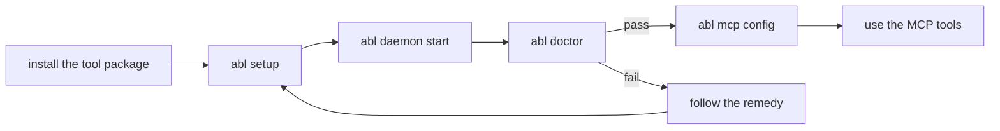

# J-06 Fresh setup (hypothesis)

**Who**: asset agent · **Area**: Setup · **Surfaces**: the `abl` CLI; the agent's MCP client
configuration

## Intent

Install AgentBlender, find Blender, start the daemon, check it and connect an MCP client, alone,
so 3D work becomes available in the same session.

## Situation

A developer workstation (Linux x64, or an Apple silicon Mac) with Blender installed by the user
and a .NET SDK. The agent has no source checkout, no prior configuration, and cannot answer
interactive prompts.

## Scenario

1. Installs the `agentblender` tool package.
2. Runs `abl setup`: Blender is discovered, its version checked, and a private config written.
3. Starts the daemon; the command returns once a worker is warm, or fails fast with a check ID.
4. Runs `abl doctor`: stable check IDs, a real worker round trip and a remedy per failure.
5. Prints the one MCP client entry with `abl mcp config` and connects.
6. Reads the server instructions: when 3D helps, and when the job belongs to AGD (C-07).

## Variations

- **Blender not found, or not on the supported 5.2 line**: setup and doctor name the found and
  supported versions and the download page; AgentBlender never downloads Blender.
- **An untrusted config file** (writable by others, or owned by another user): refused before it
  is read, naming the file and the check.
- **The daemon already runs for this store**: one daemon per store; start reports it.
- **A user service is wanted**: `abl daemon install-service` writes a systemd user unit or a
  launchd agent.
- **A web page in the same user's browser** tries to reach the daemon: refused (C-03).
- **A repeat run**: setup changes nothing and says so.

## Success

A fresh agent goes from install to a working MCP connection with no source build, no hand-set
environment and no wrapper scripts (R-11). For the business: the bet becomes testable, because
setup cost no longer limits agents to smoke previews.
